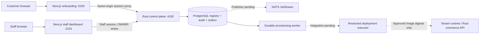

> Current increment (2026-11-12): the staff dashboard, explicit OWNER/VIEWER membership, payment confirmation and durable suspend/archive controls are implemented. The earlier phase descriptions below are historical; staff OIDC/MFA remains deferred. See the [staff operations contract](../README.md#staff-operations-dashboard) and [verification record](verification.md).

# Initial inventory and implementation plan

Inspected 21 October 2026. This workspace initially contained only the 16 architecture Markdown files and their ZIP archive. No control-plane source, tests, migrations, identity integration, or deployment gates existed here.

Read-only inspection found the existing project at `/Users/momar/Documents/commerce-ai`. The user confirmed https://github.com/rocento/rocento (private, default branch `main`); its demo source was read through authenticated GitHub API and matches the local catalog. The adjacent checkout has no `origin` remote and contains unrelated edits, so it is treated only as a read-only discovery source, not as an approved release. Its `frontend/apps/website/lib/site.ts` lists pharmacy, jewelry, grocery and electronics; `demo-presets/<category>/theme.json` contains their configuration. Website preview artwork is in the onboarding app's public assets. Its `.env.example` leaves demo destinations empty: URLs and approved digests remain unverified and are not invented here. The main commerce gateway is the Rust workspace in `commerce-api/rocento-api`; the onboarding control-plane API is a separate Rust package in this module and does not replace or share the commerce gateway.

The customer onboarding Next.js app and staff operations dashboard live at `../../../commerce-web/apps/onboarding` and `../../../commerce-web/apps/onboarding-ops`, inside the existing pnpm frontend workspace. This module contains the control-plane API and database.

## Components and trust boundaries

The local customer account, email-link verification/reset, server-synced draft, and verified 24-hour domain reservation flow now connect through the same-origin proxy. Staff OIDC/MFA is removed from the active onboarding scope; the staff shell stays locked and its production operations remain deferred. Rocento offline payment requests and manual confirmation are implemented with explicit configuration. Approved theme releases, event publishing and tenant execution remain planned. No cloud credentials, tenant containers, release promotion or DNS mutation are part of this increment.

## Delivered foundation

- Next.js customer wizard in `../../../commerce-web/apps/onboarding` and staff dashboard in `../../../commerce-web/apps/onboarding-ops`. Anonymous drafts stay in the browser; signed-in customer drafts sync to the account.
- Customer account registration, login, email verification, password reset, rate-limited single-use challenges, encrypted local mail delivery queue, hashed opaque sessions, and host-only HttpOnly cookie proxy. This is a local account implementation, not a production identity-provider integration.
- Customer draft now synchronizes with an authenticated account using optimistic version numbers. A verified customer can atomically reserve both branded hostnames for 24 hours; Rocento offline payment follows reservation; provisioning remains disabled.
- Expired reservations now reconcile every 10 seconds and on draft/slug reads. Only tenants still in `SLUG_RESERVED` are released; the tenant and domains remain as history, the draft can reserve again with a new version, and an audit/outbox event records release. Partial unique indexes keep active names exclusive while allowing expired names to be reused.
- Rust public health, proposed plans, discovered demo catalog, authenticated slug availability, transactional store/domain reservation, and organization-scoped customer queries. Staff aggregate routes and local staff fixtures are removed.
- A local customer bearer fixture can be enabled only explicitly; production always rejects it. This is not production authentication. The staff shell remains locked and staff operations are deferred.
- PostgreSQL migration for organizations, reserved-name registry, tenants, exact unique domains, theme catalog, append-only audit, and durable outbox. Registration writes tenant, two domains, audit, and event in one transaction. Duplicate reservation returns 409; it is not yet an idempotent replay API.
- Pure domain rules for ASCII slugs, organization ownership, staff permissions, capacity ceiling and approved theme digest validation. Capacity rule is not yet a transactional placement scheduler.
- Local-only Compose for PostgreSQL, persisted JetStream and registry. No infrastructure started automatically.

## Milestones and pending migrations

The Rust foundation now has an opt-in PostgreSQL integration suite covering
account verification/reset, sessions, draft concurrency, organization isolation,
reservation races, expiry and transactional rollback. See the
[current verification record](verification.md#rust-postgresql-foundation-verification--11-november-2026)
for execution evidence and limits. Rocento offline billing is implemented as
described below; event delivery and tenant execution remain the next milestones.

1. Production readiness (deferred): when preparing for production, choose and integrate customer identity/email providers, complete the session/CSRF/rate-limit policy, and define immutable approved theme releases and selections. This local phase uses built-in customer email/password accounts and file-based email delivery; it requires no external provider setup. Staff OIDC/MFA is outside this phase; keep the staff shell locked.
2. Billing: one offline payment method for this stage, with payment requests, manual confirmation and an audit ledger. An authorized operator must verify receipt of funds, amount, currency and covered service period before activating entitlement. Payment evidence submitted by a customer does not itself activate entitlement. Paddle integration, payment-provider webhooks and automatic recurring collection are deferred.
3. Orchestration: durable jobs/steps, JetStream outbox publisher/consumer, bounded retry/reconciliation and entitlement revalidation. No fake ACTIVE status.
4. AWS Launch first: pools, instances, locked allocations; benchmarked headroom; approved architecture-compatible release catalog; isolated local executor before authorized staging Terraform. Existing capacity bypasses Terraform.
5. Growth/Enterprise, recovery, GCP, security/load/isolation verification. Staff operations can be reconsidered separately. Preserve legacy `admin.rocento.com` until separately approved migration.

## Current billing scope — 11 November 2026

The user selected **Rocento** as the single offline payment method for this stage.
The customer flow should display that name and its instructions without a
payment-method selector.
The proposed flow is payment request → awaiting payment → operator confirmation
→ entitlement eligible for provisioning. Provisioning must still enforce the
approved-release and readiness gates; payment confirmation alone does not mean
the store is active.

Rocento is the selected method name; payment instructions have not yet been
specified. Do not assume bank transfer, cash collection, account details or an
external payment-provider API.
The authorized operator uses a dedicated server-side identity and token through
the loopback API; the staff shell remains locked. Confirmation must be
auditable and safe to retry without granting entitlement twice.

Implemented on 12 November 2026: payment requests, a dedicated operator-token
confirmation capability, append-only confirmation records, service-day credit,
audit/outbox writes and customer payment status. Migration 004 normalizes draft
payment to `ROCENTO`. Payment terms and instructions must be configured explicitly;
no commercial rates or payment destination are supplied. See the
[billing guide](../README.md#rocento-offline-billing).

## Risks and unresolved decisions

- Production identity provider and subject-to-organization mappings are unknown. Local signup creates one organization per account; production identity, organization membership, and abuse controls still need design.
- Demo categories/configurations are discovered; actual deployment strategy (configuration bundle versus distinct images), URLs, release approval evidence, versions and ARM64 compatibility require inspection of authorized release artifacts. No placeholder digests.
- Existing release gates must be inventoried and honored before any executor implementation. Never publish or promote artifacts as part of scaffolding.
- Proposed prices, payment terms, resource profiles and SLOs are not commercial or performance guarantees.
- Outbox is persisted but not consumed. Consumers must revalidate tenant lifecycle state before acting on an earlier reservation event. Payment confirmation queues the tenant and writes an event; route activation, Terraform and deployment endpoints remain absent.

## Initial implementation verification (before the Rust API move)

Type checking, domain/account tests, production builds, API smoke, and browser checks pass locally. PGlite validates all three migrations, account verification/reset, session revocation, draft versioning, paired-domain reservation and expiry/reuse, outbox/audit writes, and rollback. Validate SQL in isolated PostgreSQL before staging: migration reapply, multi-connection concurrency, outbox/audit rollback and organization isolation. Start local Docker explicitly via the README; no production credentials. Before staging, add identity/session-provider tests, verified billing replay/reordering tests, worker crash recovery, exact-host rejection, tenant network/data isolation and approved-image architecture checks. Infrastructure changes still require explicit approval under the original brief.

Rollback of this foundation: stop local processes; preserve database volumes. Migrations are forward-only; restore a verified local snapshot rather than dropping tenant data. Do not use `docker compose down -v` against valuable data.

## Provisioning orchestration — 12 November 2026

Implemented migration 005, transactional payment-event consumption, leased jobs,
bounded safe retries, append-only evidence, eligibility rechecks and atomic
activation/coverage start. Customer status polling is connected through the
same-origin proxy. Existing confirmed stores are backfilled on worker startup.
The approved merchant release, real host executor and merchant DNS are still
required before any AWS store can become ACTIVE. See the API README for the
executor contract and the verification history for test scope.
