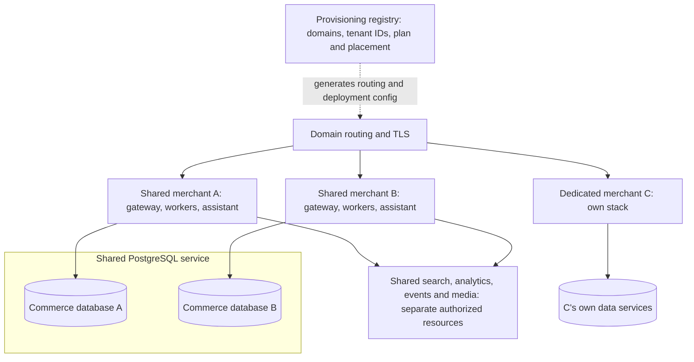

# Rocento: dedicated and shared hosting study

Prepared 18 September 2026. **Recommendation for study; not implemented or capacity-tested.** Here, a *tenant* means a merchant business using Rocento, not an individual shopper.

## Recommendation

Yes. Offer two hosting plans using the same Rocento application, container images, database migrations and release process:

- **Shared:** several merchants share infrastructure, with enforced separation of their data and credentials.
- **Dedicated:** a merchant has its own application stack and data services, with compute placement defined by the purchased plan.

Start Shared with **one logical commerce database per merchant on a shared PostgreSQL server**, while retaining a small application deployment per merchant. Share the heavier infrastructure progressively after adding resource configuration and access controls. Consider a shared application runtime later, when measurements justify the additional engineering.

This is my recommendation based on Rocento's current source. AWS describes offering pooled and dedicated environments within one product as [tier-based isolation](https://docs.aws.amazon.com/whitepapers/latest/saas-tenant-isolation-strategies/tier-based-isolation.html). For PostgreSQL, a separate logical database per tenant on a shared server is a [bridge model](https://docs.aws.amazon.com/prescriptive-guidance/latest/saas-multitenant-managed-postgresql/matrix.html).

## 1. What the customer buys

| Question | Shared plan: recommended first version | Dedicated plan |
| --- | --- | --- |
| Who is it for? | Smaller merchants comfortable sharing infrastructure | Merchants requiring more control, isolation or predictable resources |
| Application | Same release; initially separate gateway, workers and assistant processes per merchant | Own application deployment, using the same release family |
| Commerce data | Own logical database and restricted credentials on a shared database server | Own database service and credentials |
| Search, reporting, events and media | Shared services with separate authorized resources, added in stages | Own service instances or explicitly dedicated resources |
| Capacity | Published limits and fair usage; competing workloads must be controlled | Purchased resource allocation and separately defined limits |
| Recovery | Per-merchant restore procedure plus shared-service recovery | Recovery scoped to the dedicated deployment |
| Cost | Expected lower infrastructure cost per merchant, with engineering and operations overhead | Higher infrastructure cost; charge for the resources and operational commitments |
| Moving plans | Supported migration to Dedicated, with a tested maintenance window initially | May move back after a compatibility and capacity check |

**Separate Docker containers on one EC2 instance still share the host, disk resources and host failure.** That describes application separation, not a dedicated server. Keep these distinctions explicit in pricing: a dedicated stack on shared compute, a dedicated EC2 instance, and an optional separate AWS account are different offerings. An EC2 instance also does not imply physically dedicated hardware.

Both plans need tenant data isolation. Shared customers receive the same functional privacy boundary; they accept more infrastructure and performance sharing. Availability, backup retention and support response commitments should be stated separately from the hosting label.

## 2. Why this fits the current project

The inspected source assumes a separate commerce installation for each merchant. Some assistant/support records already carry tenant identifiers, but that does not make the whole commerce system ready for shared tables.

| Current evidence | Consequence for the proposed Shared plan |
| --- | --- |
| [Client onboarding](../deployment/client-onboarding.md) explicitly requires independent deployments/databases and says sales channels do not isolate clients | A merchant needs its own installation boundary; do not use sales channels as tenants |
| [Gateway startup](../../../commerce-api/rocento-api/crates/api-gateway/src/main.rs) loads a deployment-wide `DATABASE_URL`, application state and workers | Separate app processes can keep this model initially; pooling application processes requires new tenant-aware state and routing |
| [Catalog](../../../commerce-api/rocento-api/migrations/20260913020000_catalog.sql) and [identity](../../../commerce-api/rocento-api/migrations/20260913010000_identity.sql) define merchant-local tables and uniqueness rules | Mixing merchants into these tables requires a broad schema/query/authentication migration |
| [Search client](../../../commerce-api/rocento-api/crates/domain-search-client/src/lib.rs) uses `/indexes/products/...` | Add a configured tenant index and enforce credentials scoped to that index |
| [Analytics client](../../../commerce-api/rocento-api/crates/api-gateway/src/analytics.rs) uses `commerce_analytics` | Parameterize the database and restrict each merchant's database user |
| [Event infrastructure](../../../commerce-api/rocento-api/crates/infra-events/src/lib.rs) uses `COMMERCE_EVENTS` and `commerce.>`; consumers also use fixed names | Keep tenants in separate authorized messaging namespaces before sharing the server |
| [Media store](../../../commerce-api/rocento-api/crates/infra-media/src/lib.rs) uses `commerce-media` | Add configured buckets or prefixes with storage policies that enforce the separation |
| [Assistant authentication](../../../commerce-assistant-platform/app/commerce_action_engine/platform/security.py) validates one configured tenant; [provider settings](../../../commerce-assistant-platform/app/commerce_resolution_engine/providers/settings.py) use a deployment-local tenant-bound file | Retain a separate assistant process/configuration initially; a pooled assistant needs tenant-specific configuration, secrets and budgets |

Simply pointing all current stacks at the same database, search index or event account would break the intended boundaries. Configuration work and isolation tests must precede consolidation.

## 3. Proposed first Shared architecture

The registry is initially an operations inventory and provisioning input. It need not become a new dependency for every checkout request. It records an immutable tenant ID, verified domains, plan, placement, resource names, secret references, limits and release/schema version. Actual secrets belong in protected secret storage.

For example, grocery merchant A and electronics merchant B could share one PostgreSQL server while using databases `commerce_a` and `commerce_b`. Their products, customers and orders remain in different databases. Their catalog schemas can remain structurally identical while their industry attributes, branding and business settings differ through existing configuration.

### Infrastructure boundaries to implement

| Service | Proposed starting boundary | Work required |
| --- | --- | --- |
| PostgreSQL | Database per merchant; separate restricted runtime and migration credentials | Explicit database privileges, connection budgets, automated migrations and restore procedures |
| Meilisearch | Index per merchant; separate read/indexing permissions | Parameterize every index operation; replace deployment use of a shared master key with scoped keys |
| ClickHouse | Database per merchant with a restricted user | Parameterize database initialization, writes, queries, exports and reporting jobs |
| NATS JetStream | Account per merchant | Add authenticated account configuration and account limits; verify publishers, consumers and replay remain isolated |
| Object storage | Bucket per merchant initially | Configurable bucket names, scoped credentials/policies, private access and authorized downloads |
| Assistant | Process/configuration per merchant; own logical assistant database | Preserve separation from commerce storage; configure runtime/writer roles, key ownership, history and RAG resources |
| Edge and frontend | Shared static build and hostname routing | Verified domain ownership, reject unknown hosts, correct cache keys and merchant-specific configuration |

Names identify resources; **permissions enforce isolation**. PostgreSQL grants database `CONNECT` and `TEMPORARY` to `PUBLIC` by default, so privileges must be deliberately restricted. See [PostgreSQL privileges](https://www.postgresql.org/docs/16/ddl-priv.html). Runtime roles should not be superusers or have access to other merchants' databases.

NATS accounts provide isolated communication contexts; this is preferable here to relying only on naming conventions. See the [NATS account documentation](https://docs.nats.io/learn/security/accounts-and-multitenancy). Meilisearch distinguishes its master key from restricted API keys; validate the precise permissions against the deployed version. See [Meilisearch security](https://www.meilisearch.com/docs/resources/self_hosting/security/overview).

Keep an infrastructure service dedicated until its shared boundary has passed verification. Consolidation can happen one service at a time.

## 4. Shared application processes are a later option

There are three distinct steps, with increasing potential savings and engineering work:

| Design | What is shared? | Assessment for Rocento |
| --- | --- | --- |
| A. Shared infrastructure | Database/search/event servers; each merchant retains application processes and separate resources | Recommended first version |
| B. Shared application runtime | Gateways/workers serve multiple merchants; commerce databases remain separate | Possible next step after A is stable and application overhead is measured |
| C. Shared commerce tables | Application and tables are shared; rows carry tenant IDs | Defer until scale and economics justify a much broader migration |

For B, resolve the merchant from an approved domain/route, validate authenticated membership, and select a server-owned tenant configuration. Do not trust a browser-provided tenant ID as authorization. Anonymous storefront browsing must also resolve a tenant safely. Database pools, workers, sessions, reset links, payment webhooks, exports, media, caches and rate limits all need correct tenant routing. Missing or conflicting tenant context must fail closed.

For C, tenant IDs would need to participate in queries, ownership checks, uniqueness constraints and foreign keys throughout commerce. PostgreSQL row-level security can add defense, but owners, superusers and `BYPASSRLS` roles have special bypass behavior. Connection reuse also needs correct transaction-scoped context. See [PostgreSQL row security](https://www.postgresql.org/docs/current/ddl-rowsecurity.html). Adding a `tenant_id` column alone is insufficient.

## 5. Assistant and RAG implications

The hosting plan must not change which merchant's data the assistant is allowed to see. Product tools, orders, conversations, approved documents, embeddings and cached responses must remain tenant-scoped. Any future pooled assistant must select the merchant's provider settings and tools for each request; the current one-tenant configuration is not suitable unchanged.

Choose an explicit commercial model for AI: merchant-owned provider credentials, or Rocento-managed usage billed/limited per merchant. For the latter, implement metering and enforceable concurrency/token budgets so one merchant cannot exhaust shared allowances. Never include raw provider keys in the provisioning registry, logs or support reports.

The [AI service documentation](../../ai-service/README.md) recorded intermittent provider connectivity and document RAG not enabled in the inspected local runtime. This hosting proposal does not resolve those issues or establish assistant readiness.

## 6. Operations, recovery and economics

**Prevent resource starvation.** Set per-merchant limits for request bursts, DB connections, simultaneous exports/imports, index jobs, storage and assistant concurrency. Track latency, failures, queue age and resource consumption by tenant. Existing gateway code permits up to 10 primary DB connections plus a reporting connection; workers and other services add demand. Budget the aggregate before consolidating databases.

**Keep restores tenant-specific.** A logical database per merchant simplifies export/import, but a shared database server's physical backup or point-in-time restore concerns the server/cluster. Recover into a temporary environment and extract the selected merchant when necessary; rehearse this procedure. AWS's [PostgreSQL decision matrix](https://docs.aws.amazon.com/prescriptive-guidance/latest/saas-multitenant-managed-postgresql/matrix.html) describes these recovery tradeoffs.

**Use one release process.** Deploy the same images with different configuration. Track schema versions and run migrations in controlled batches. Keep merchant customization in supported settings rather than divergent source branches. Separate privileged Rocento operations access from each merchant's administration permissions.

**Measure total cost.** Compare compute, database/storage, backups, traffic, monitoring, AI usage and operational time. Shared infrastructure is likely to reduce repeated service overhead, but per-merchant tables, indexes and stored data still consume resources. Migration engineering has a cost, so a handful of merchants may remain cheaper to operate as independent stacks initially.

The earlier ten-merchants × 100-orders/day scenario is not enough to size Shared. Peak browsing, searches, catalog size, imports and simultaneous assistant requests determine much of the demand. No capacity guarantee for a `t4g.xlarge`, cost saving percentage or production SLA follows from this design. A single shared host remains a common failure point.

## 7. Recommended sequence and acceptance gates

1. **Define the two plans and inventory deployments.** Record tenant IDs, domains, placement, versions and resource references. Document what “Dedicated” means at the compute and storage layers.
2. **Build a disposable two-merchant proof of concept.** Start with shared PostgreSQL and separate databases, app processes and credentials. Preserve the current catalog schema. Prove isolation, migration and recovery before adding other shared services.
3. **Parameterize and consolidate selected services.** Add restricted search indexes, analytics databases, NATS accounts and object buckets. Keep runtime and provisioning credentials separate. Preserve the Dedicated deployment path with the same code/images.
4. **Test boundaries and competing workloads.** Use deliberate tenant-A/tenant-B access attempts across orders, sessions, search, exports, events, media and assistant context. Test the same SKU/email in two stores, missing/forged tenant context, queue retries and worker restarts. Run imports for A while measuring B's browsing and checkout latency.
5. **Rehearse Shared → Dedicated migration.** Pause source writes and workers; drain/reconcile pending events; copy commerce and assistant data, media and configuration; rebuild indexes; validate; switch routing; resume. Ensure only one writable deployment. Define rollback before cutover; switching back after new writes requires reconciliation, not just a DNS reversal.
6. **Pilot, measure and then expand.** Agree on latency, error-rate, recovery and resource-headroom targets before testing. Start with a small merchant group. Add shared application processes only if their measured overhead warrants the work.

No deployment, infrastructure migration or load test was performed for this study. The immediate decision I recommend is: **keep Dedicated available and investigate design A for Shared; defer shared commerce tables.**

## Study questions

- What monthly infrastructure and operational cost can each plan support?
- Does Dedicated mean separate containers, separate EC2/database instances, or a separate AWS account?
- What downtime and data-loss limits will each plan promise, and have restores demonstrated them?
- Which limits will protect shared merchants from large imports, search reindexing and AI bursts?
- Can one merchant move plans without changing their domain, customer identities or order history?

Read [AWS tier-based isolation](https://docs.aws.amazon.com/whitepapers/latest/saas-tenant-isolation-strategies/tier-based-isolation.html) first, then the [PostgreSQL model comparison](https://docs.aws.amazon.com/prescriptive-guidance/latest/saas-multitenant-managed-postgresql/matrix.html), and compare them with the concrete Rocento changes above.
